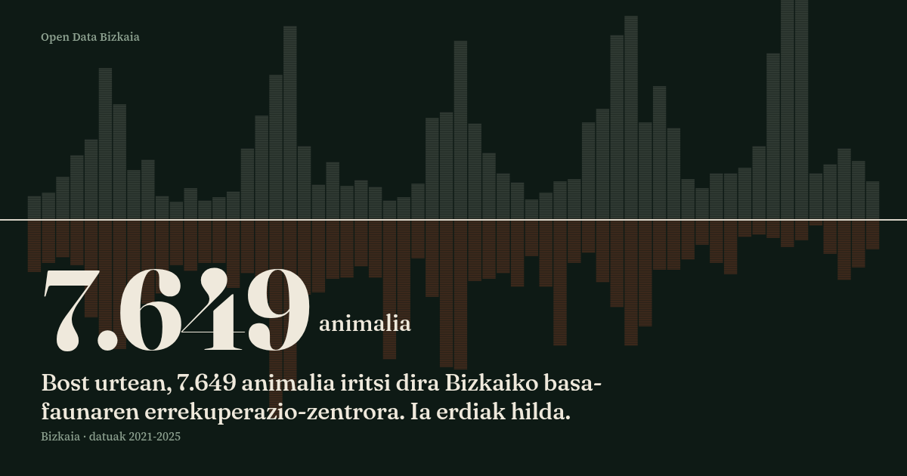

# Zer iristen den

Bizkaiko basa-faunaren errekuperazio-zentrora **7.649 animalia** iritsi dira bost
urtean, 294 espezietakoak. Ia erdiak hilda. Eta bizirik iristen direnetatik,
zergatik iritsi ziren erabakitzen du bizirik aterako diren.



## Zer erakusten duten datuek

| | Kopurua | Ehunekoa |
|---|---|---|
| Animaliak guztira, 2021–2025 | 7.649 | — |
| Hilda iritsiak | 3.605 | % 47,1 |
| Bizirik iritsiak | 4.044 | % 52,9 |
| Askatuak (bizirik iritsitakoen artean) | 1.800 | % 44,6 |
| Hil edo sakrifikatuak | 1.933 | % 47,9 |

Bi egutegi daude eraikin berean. **Txitak** udan iristen dira — uztailean 1.447
animalia, abenduan 309 — eta 2.068 dira guztira, laurenetik gora. **Kentzeko**
iristen direnek beste erritmo bat dute: 1.064 animalia, ekaina eta otsaila
gailur, eta ia denak basurdeak eta Floridako dortokak.

Bizirauteko aukerak sartzeko arrazoiaren araberakoak dira:

| Zergatik iritsi zen | Askatuak |
|---|---|
| Txita, habiatik erorita | **% 61,6** |
| Ahultasuna | % 47,6 |
| Traumatismoa | % 39,9 |
| Tiroa | % 31,4 |
| Autoak harrapatuta | % 28,8 |
| Populazio-kontrola | % 7,6 |
| Jabe batek entregatua | **% 1,9** |
| Espeziea ezabatzea | **% 0,0** |

Azken hori ez da albaitaritza-kontua. Jabeak entregatzen duena ia beti
**Floridako dortoka** bat da: espezie inbaditzailea, eta legeak ezin du naturara
itzuli. 339 iritsi ziren horrela, 312 bizirik, eta **sei** itzuli ziren.

## Iturria

[Open Data Bizkaia](https://www.opendatabizkaia.eus/es/catalogo/centro-recuperacion-fauna),
`centro-recuperacion-fauna` datu-multzoa, CKAN `datastore_search` APIaren bidez.
Bost baliabide, urte bana: **2021–2025**, 7.649 erregistro, 19 eremu.

Kontuan hartzekoak:

- **Izenak bateratu behar izan dira.** Iturriak maiuskulak eta minuskulak
  nahasten ditu («AVES» eta «Aves»), eta horrek espezie bera birritan zenbatzea
  eragiten du: **380 etiketa, 294 espezie**. 42 espeziek ez dute euskarazko
  izenik iturrian.
- **Iturriak akatsak ditu**, eta ez ditugu zuzendu: *Larus michaellis*
  (*michahellis* beharrean), *Columba libia* (*livia*), *Accipiter nissus* eta
  *nisus* biak. Zuzenduz gero, orria eta iturria ezin dira alderatu.
- **Emaitza ezezaguna** 3.616 erregistrotan, ia denak hilda iritsitakoenak.
  Bizirauteko ehunekoak bizirik iritsi eta emaitza ezaguna dutenen gainean
  kalkulatzen dira beti.

## Nola eraiki

```
python3 build.py      # datuak jaitsi (~7 MB data/raw.json)
python3 compact.py    # data/fauna.json sortu
python3 assemble.py   # ../zer-iristen-den.html muntatu
node make-og.js       # ../zer-iristen-den-og.png sortu
```

Lehen bi urratsak behin bakarrik behar dira: `data/fauna.json` biltegian dago.

```
SITE_URL=https://adibidea.eus/fauna python3 assemble.py
```

Hutsik utziz gero, URL absolutua behar duten etiketak (`og:url`, `canonical`)
kendu egiten dira.

## Hiru dimentsioko irudiak

Sei animalien atalean biraketa aurre-errendatuak daude: **36 fotograma espezie
bakoitzeko**, Blenderren eginak, hondo gardenarekin. Ez da WebGL — irudi-sekuentzia
bat da, arrastatuz aurrera eta atzera doana. Hala argiztapena errendatze-kalitatekoa
da eta orriak ez du kanpo-liburutegirik behar.

| Espeziea | Jatorria | Lizentzia |
|---|---|---|
| *Bubo bubo* | MNHN Paris, ale eskaneatua (MNHN-ZO-MO-2003-2723), **pierreyves.gagnier** | CC BY |
| *Columba livia* | **kenchoo** | CC BY |
| *Emys orbicularis* | **arribadaclub** | CC BY |

Hirurak **irudikapenak** dira, ez animalia zehatz horien argazkiak: iturriak ez
dakar irudirik. Eta dortokarena ez da erregistroko espeziea — *Mauremys
leprosa*-ren eskanerik ez dago inon, eta *Emys orbicularis* da hurbilen dagoen
ur-dortoka bertakoa. Orrian esplizituki esaten da, irudiaren azpian.

Errendatzeak `renders/` karpetan daude (PNG, 720×720) eta weberako bertsioak
`img/`-n (WebP, 520×520, 2 MB guztira).

## Fitxategiak

```
zer-iristen-den.html       orri osoa, fitxategi bakarrean (369 KB)
zer-iristen-den-og.png     partekatzeko txartela
img/                       biraketen irudiak (108 WebP, 2 MB)
renders/                   Blenderren errendatze gordinak (108 PNG, 33 MB)
build.py                   Open Data Bizkaiatik jaitsi
compact.py                 izenak bateratu eta formatu trinkora pasatu
assemble.py                burua + gorputza + datuak + gidoia → orri bakarra
make-og.js                 txartela atera (Chrome, CDP bidez)
page.head.html             metadatuak eta CSS osoa
page.body.html             egitura
page.script.html           itzulpenak eta bistaratze-kodea
data/fauna.json            orriak jaten duen datu-multzoa (272 KB)
data/six.json              sei animalien fitxak
AURKEZPENA.md              sarirako dokumentazio teknikoa (eu/es)
```

`data/raw.json` (7 MB) ez dago biltegian: `build.py`-k berriro sortzen du.

## Nola dagoen egina

Bistaratzea **eskuz idatzitako canvas, SVG eta JavaScript hutsa** da,
kanpo-liburutegirik gabe: 7.649 laukizuzen fotograma bakoitzean. Animaliak ez
dira inoiz berriro sortzen, dauden lekutik mugitzen dira — marra agertzen
denean, animalia berberak ikusten dituzu bi aldeetara banatzen.

Tipografia: **Fraunces** (izenburuak) eta **Source Serif 4** (irakurketa eta
grafikoak), natura-historiako plaka zahar baten moduan; izen zientifikoak
etzanez. Kolore-sistemak bi kolore ditu — hezurra (animalia bat) eta oxidoa (ez
zen bizirik atera) — eta azpimarratzeko ez da hirugarrenik sartzen: gainerakoa
ilundu egiten da.

Orriak euskaraz eta gaztelaniaz funtzionatzen du, egoera URLan gordetzen du
(`#lang=es&show=bird`), CSV gisa deskargatzen uzten du, teklatuz nabigatzen da
eta paperean inprimatzen da (10 orrialde A4).

## Lizentzia

| Zer | Lizentzia |
|---|---|
| Kodea | MIT |
| Testuak eta grafikoak | CC BY 4.0 |
| 3D modeloak | Egileenak, CC BY — ikus goiko taula |
| Datuak | Bizkaiko Foru Aldundiarenak, Open Data Bizkaia |
